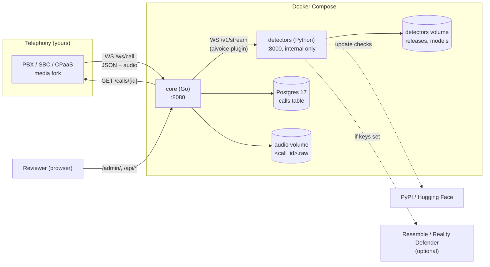
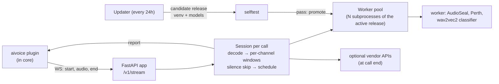

# Architecture and code design

This is the design document for the call-audio analysis system: what it is for, how it is put together, why it is built this way, and where it is going. It describes the code as it is in this repository. Each section links to the source it describes.

Contents:

1. [Purpose and scope](#1-purpose-and-scope)
2. [Goals and non-goals](#2-goals-and-non-goals)
3. [System context](#3-system-context)
4. [Components](#4-components)
5. [Data model](#5-data-model)
6. [Call lifecycle](#6-call-lifecycle)
7. [Concurrency model](#7-concurrency-model)
8. [Failure handling](#8-failure-handling)
9. [Storage and retention](#9-storage-and-retention)
10. [The AI-voice detector service](#10-the-ai-voice-detector-service)
11. [Security](#11-security)
12. [Design decisions](#12-design-decisions)
13. [Future work](#13-future-work)
14. [Testing strategy](#14-testing-strategy)
15. [Repository layout](#15-repository-layout)

---

## 1. Purpose and scope

The system scans phone-call audio for security-relevant signals. The first signal is **AI-generated voices**: deepfake callers, cloned voices and synthetic agents. The design is general. Any analysis that can consume a stream of audio plus call metadata can be added as a plugin.

The repository contains:

- **The core** (Go): ingests calls over a WebSocket, fans the audio out to analysis plugins live, stores the call, its audio and every plugin's results, enforces retention, and serves an API and an admin UI.
- **Plugins** (Go, compiled into the core): `audiostats`, a minimal example, and `aivoice`, a client of the detector service.
- **The detector service** (Python): runs AI-voice watermark detectors and synthetic-speech classifiers, and keeps them up to date from upstream.
- **Deployment:** Docker Compose with Postgres.

## 2. Goals and non-goals

**Goals**

| # | Goal | How it is met |
|---|---|---|
| G1 | Any telephony source can integrate with minimal work | A tiny protocol: one JSON message, then raw bytes ([websocket-api.md](websocket-api.md)) |
| G2 | Analyze while the call is happening, not after | Plugins consume a live stream from the first byte (§6, §7) |
| G3 | A slow or broken plugin never affects ingestion or other plugins | Per-plugin unbounded queues, plus timeouts and panic isolation (§7, §8) |
| G4 | Every accepted call is stored, even on abrupt hangup | A hangup is treated as the end of audio, and the save path is independent of the client (§6) |
| G5 | Bounded data retention | `expires_at` on every call, plus a cleanup task (§9) |
| G6 | Plugins are easy to write | A two-method interface, free-form JSON output, compiled in ([plugins.md](plugins.md)) |
| G7 | AI-voice detection stays current without manual work | Upstream-tracking updater with self-tests and rollback (§10) |
| G8 | Results are reviewable by humans | An admin UI embedded in the core |

**Non-goals (for now)**

- Real-time intervention, such as alerts during the call or blocking the call. Results arrive when the call ends.
- Being in the media path. The core is a passive side channel, and a failure never affects the phone call itself.
- Transcoding or interpreting audio in the core. The audio format is metadata for plugins.
- Multi-tenant isolation, user management and fine-grained authorization.
- Horizontal scaling of a single call. One call is handled by one core process.

## 3. System context



- Only the core is published to the host. Postgres and the detector service are reachable only on the Compose network.
- The detector service makes outbound requests to PyPI and Hugging Face for updates, and to commercial detection APIs only if they are configured.

## 4. Components

### 4.1 Packages

| Package | Responsibility | Depends on |
|---|---|---|
| [`cmd/core`](../cmd/core/main.go) | Wiring: config, database, plugins, engine, server, admin, cleanup, signal handling and graceful shutdown | everything below |
| [`internal/config`](../internal/config/config.go) | Environment variables → `Config`, with defaults and validation | |
| [`internal/call`](../internal/call/call.go) | The `Call` struct: the unit of storage and of the API | |
| [`internal/audio`](../internal/audio/broadcast.go) | `Broadcaster` (one writer, many readers, plus a sink) and `Stream` (one reader's queue) | |
| [`internal/plugin`](../internal/plugin/plugin.go) | The `Plugin` interface, `Input`, and the process-wide registry | `audio` |
| [`internal/engine`](../internal/engine/engine.go) | Runs every plugin for a call: subscription, goroutines, timeout, panic recovery, result collection | `audio`, `plugin` |
| [`internal/server`](../internal/server/ws.go) | The WebSocket call protocol, `GET /calls/{id}`, `/healthz`, and tracking in-flight calls for shutdown | `audio`, `call`, `config`, `engine`, `store` |
| [`internal/store`](../internal/store/store.go) | Postgres: embedded migrations, save/get, expiry queries, admin list and stats queries | `call` |
| [`internal/retention`](../internal/retention/cleanup.go) | Periodic deletion of expired calls and their audio | `store` |
| [`internal/admin`](../internal/admin/admin.go) | Admin UI (embedded static files), read-only `/api`, basic auth, security headers, raw → WAV conversion | `call`, `store` |
| [`plugins`](../plugins/all.go) | Blank imports that link each plugin into the binary | each plugin |
| [`plugins/audiostats`](../plugins/audiostats/audiostats.go) | Example plugin: frame and byte counts, duration | `plugin` |
| [`plugins/aivoice`](../plugins/aivoice/aivoice.go) | Streams the call to the detector service and returns its report | `plugin` |
| [`cmd/streamcall`](../cmd/streamcall/main.go) | Test client | |

The dependencies point one way. `audio`, `call` and `config` depend on nothing internal, and plugins depend only on `plugin` and `audio`, so a plugin can't reach into the server or the store.

### 4.2 Key types

```go
// internal/call
type Call struct {
	ID         string                     // UUID, generated by the core
	Variables  map[string]any             // first WebSocket message
	Results    map[string]json.RawMessage // plugin name → JSON output
	AudioPath  string                     // AUDIO_DIR/<id>.raw (not exposed in the API)
	AudioBytes int64
	StartedAt, EndedAt, ExpiresAt time.Time
}

// internal/audio
func NewBroadcaster(sink io.Writer) *Broadcaster
func (*Broadcaster) Subscribe() *Stream
func (*Broadcaster) Publish(frame []byte) error // copies the frame once, shares it with all streams
func (*Broadcaster) Close()                       // streams get io.EOF after draining
func (*Stream) Next(ctx) ([]byte, error)
func (*Stream) Read(p []byte) (int, error)
func (*Stream) Release()

// internal/engine
func New(plugins []plugin.Plugin, timeout time.Duration, log *slog.Logger) *Engine
func (*Engine) Start(ctx, callID, vars, b *audio.Broadcaster) *Run // subscribes and starts plugins
func (*Run) Wait() map[string]json.RawMessage                       // after audio ends: timeout, collect

// internal/store
type Store interface {
	Save(ctx, *call.Call) error
	Get(ctx, id) (*call.Call, error)                 // ErrNotFound if missing or expired
	Expired(ctx, now, limit) ([]Expired, error)
	Delete(ctx, id) error
}
// plus (*Postgres).List(ctx, ListQuery) and (*Postgres).Stats(ctx) for the admin UI
```

The server and the cleaner depend on the `Store` interface, and the admin UI on its own narrower `admin.Store`. Tests substitute in-memory fakes, so no database is needed.

## 5. Data model

### 5.1 Postgres

[`001_calls.sql`](../internal/store/migrations/001_calls.sql) and [`002_calls_started_at.sql`](../internal/store/migrations/002_calls_started_at.sql):

```sql
CREATE TABLE IF NOT EXISTS calls (
    id          uuid        PRIMARY KEY,
    variables   jsonb       NOT NULL DEFAULT '{}'::jsonb,
    results     jsonb       NOT NULL DEFAULT '{}'::jsonb,
    audio_path  text        NOT NULL DEFAULT '',
    audio_bytes bigint      NOT NULL DEFAULT 0,
    started_at  timestamptz NOT NULL,
    ended_at    timestamptz NOT NULL,
    expires_at  timestamptz NOT NULL
);
CREATE INDEX IF NOT EXISTS calls_expires_at_idx ON calls (expires_at);              -- cleanup
CREATE INDEX IF NOT EXISTS calls_started_at_idx ON calls (started_at DESC, id);     -- admin paging
```

- **One row per call, written once,** when the call ends. There are no updates. A call in progress is not in the database.
- **`variables` and `results` are `jsonb`.** Their content is free-form by design, so no schema migration is needed when a plugin's output changes, and Postgres can still query into them. The admin filters use `results->'aivoice'->>'verdict'` and `jsonb_each(results)`.
- **Migrations** are embedded in the binary and applied in file-name order at startup. Each one is idempotent (`IF NOT EXISTS`), so there is no migrations table. Add new ones as `003_….sql`, and keep them idempotent and backward compatible, because a rolling restart runs old and new binaries against the same schema.

### 5.2 Audio files

- `AUDIO_DIR/<call_id>.raw`: the exact bytes of every binary WebSocket message, concatenated, with no header. The file is created with `O_EXCL` and mode `0600`, and written through a 64 KiB buffer as frames arrive.
- Its format is whatever the call's variables say. The admin API converts it to WAV on demand.

### 5.3 Results

`results` maps plugin name to JSON. The conventions (an object, a reserved top-level `error` key) are in [plugins.md §5](plugins.md#5-output). The `aivoice` report schema is in [detectors/README.md](../detectors/README.md#report-resultsaivoice).

## 6. Call lifecycle

The whole lifecycle lives in [`Server.handleCall`](../internal/server/ws.go). Step by step:

| # | Step | Code | Notes |
|---|---|---|---|
| 1 | Upgrade the WebSocket, and set the read limit to `MAX_FRAME_BYTES` | `websocket.Accept`, `SetReadLimit` | |
| 2 | Create `callCtx`, which expires after `MAX_CALL_DURATION` and is also cancelled at server shutdown | `context.WithTimeout` + `context.AfterFunc(s.stop, …)` | |
| 3 | Read the first message within `FIRST_MESSAGE_TIMEOUT`. It must be a JSON object text frame. | `readVariables` | On failure: close 1008, and nothing is created |
| 4 | Register as in flight (`calls.Add(1)`), create the `Call` with a new UUID and `StartedAt` | | Shutdown waits for this |
| 5 | Create the audio file, wrap it in a `bufio.Writer`, and make it the broadcaster's sink | `os.OpenFile(O_EXCL)`, `audio.NewBroadcaster` | On failure: close 1011 |
| 6 | **Start the plugins:** subscribe each one, then launch `Analyze` goroutines with a context that is *detached* from the request | `engine.Start(context.WithoutCancel(callCtx), …)` | Before `accepted`, so nothing is missed |
| 7 | Send `{"type":"accepted","call_id"}` | `writeMsg` | If this fails, go straight to step 9 |
| 8 | Pump: binary → `Publish` (sink write, then fan-out); text `end` → stop; read error → stop | `readAudio` | Returns the end reason for the log |
| 9 | `Close()` the broadcaster, flush and close the file, set `AudioBytes`, `EndedAt`, and `ExpiresAt = EndedAt + RETENTION` | | Plugins now see EOF after draining |
| 10 | **Wait for the plugins:** up to `PLUGIN_TIMEOUT`, then cancel, then a 2 s grace, then abandon | `run.Wait()` | |
| 11 | Save the row, with a fresh 10 s timeout (not the request context) | `store.Save` | On failure: close 1011, logged |
| 12 | Best effort: send `complete` and close 1000 | | The client may already be gone |

Why the plugins' context is detached (step 6): if plugins used the request context, a hangup would cancel them mid-analysis. Instead, a hangup *closes the stream* (step 9), which is the signal that the audio is over, and the engine's own timer bounds how long they may continue. `context.WithoutCancel` keeps any values on the context but none of its cancellation.

End reasons logged at step 8: `end message`, `client closed` (a close frame), `hangup` (a network error), `max call duration`, `server shutdown`, `storage error` (the sink write failed).

## 7. Concurrency model

### 7.1 Goroutines per call

```
handleCall goroutine (from net/http)          - reads the socket, publishes frames, then waits and saves
 ├─ plugin goroutine × P (engine.runOne)       - Analyze(ctx, in), then reports to Run.results
 │    └─ (plugin-internal goroutines, if any; must end before Analyze returns)
 └─ timers: first-message AfterFunc, shutdown AfterFunc, engine deadline/grace
```

With N concurrent calls and P plugins there are about N × (1 + P) goroutines, plus whatever each plugin starts (`aivoice` uses its own goroutine only, with one WebSocket per call to the detector service).

### 7.2 The broadcaster

One writer (the socket reader) and P readers:

- `Broadcaster.mu` guards the subscriber set, the closed flag, the counters and the sink. `Publish` holds it while writing to the sink and pushing to every queue. A sink write is a buffered file write, so this is fast.
- Each `Stream` has its own mutex, condition variable and queue (`[][]byte`). `push` appends and signals. `Next` waits on the condition until there is a frame, the stream reaches EOF, or `ctx` is cancelled. `context.AfterFunc` wakes the waiter on cancellation, broadcasting under the lock so the wakeup can't be lost.
- A frame is copied **once** per `Publish` and the same slice goes to every stream. That is why frames are read-only.
- Queues are **unbounded**. This trades memory for isolation: a stalled plugin grows its own queue, at most the remaining audio of that call, but never blocks the writer. Telephony audio is cheap (8 KB/s for mulaw), so this is the right trade-off here. See [§13](#13-future-work) for adding a cap.
- `Release` (called by the engine when `Analyze` returns) unsubscribes and drops the queue, so a plugin that returns early stops costing memory.

### 7.3 The engine

- `Start` creates one `Run` with a cancellable child context, a result channel buffered to P (so plugin goroutines never block when reporting), and a pending set.
- `runOne` wraps `Analyze` in a deferred `recover`, normalizes the output (an error becomes `{"error"}`, `nil` becomes `null`, invalid JSON is replaced), releases the stream, and sends the result.
- `Wait` runs on the call goroutine *after* the audio has ended. It collects results until none are pending. When the `PLUGIN_TIMEOUT` timer fires it cancels the context. After another 2 s it records every remaining plugin as `{"error":"timed out"}` and stops waiting. An abandoned goroutine's late result goes into the buffered channel and is garbage-collected with the `Run`.

### 7.4 The context tree

```
r.Context()                                   (HTTP request)
 └─ callCtx = WithTimeout(MAX_CALL_DURATION)   + cancelled by server shutdown
     ├─ used by readVariables, readAudio, writeMsg(accepted)
     └─ WithoutCancel(callCtx)                  (keeps values, drops cancellation)
         └─ runCtx = WithCancel                  cancelled by Run.Wait at PLUGIN_TIMEOUT
             └─ passed to every Analyze
context.Background() + 10s                    used for Save (independent of the client)
context.Background() + 5s                     used for the final "complete" write
```

### 7.5 Shutdown

[`cmd/core/main.go`](../cmd/core/main.go) on SIGINT or SIGTERM:

1. `http.Server.Shutdown`: stop accepting new connections. Hijacked WebSocket connections are not tracked by `net/http`, so this doesn't wait for calls.
2. `server.Shutdown`: cancel `s.stop`, which cancels every `callCtx`. Each in-flight call's read fails, so it proceeds through steps 9–12 normally: plugins finish and the result is saved. Then wait on the `calls` WaitGroup, bounded by `SHUTDOWN_TIMEOUT`.
3. Stop the cleanup goroutine, and close the database pool.

Compose's `stop_grace_period: 90s` is longer than `SHUTDOWN_TIMEOUT` (60 s), which leaves time for `PLUGIN_TIMEOUT` plus the save.

## 8. Failure handling

| Failure | Detected by | Effect on the call | Effect on others |
|---|---|---|---|
| Bad or missing first message | `readVariables` | Rejected with 1008, nothing stored | none |
| Client hangs up mid-call | Read error in `readAudio` | The audio ends there. Plugins finish, and the call is saved. | none |
| Message over `MAX_FRAME_BYTES` | WebSocket library (closes 1009) | Same as a hangup | none |
| Call exceeds `MAX_CALL_DURATION` | `callCtx` deadline | Same as a hangup | none |
| Plugin returns an error, panics or returns invalid JSON | engine `runOne` | That plugin's result is `{"error": …}` | none |
| Plugin is slow or stuck | engine `Wait` timer | `{"error":"timed out…"}` after `PLUGIN_TIMEOUT` (+2 s) | none, but the save is delayed by up to the timeout |
| Detector service down or rejecting the call | `aivoice` dial or handshake | `results.aivoice = {"error": …}` | none |
| Detector service slow (backlog) | detector session | Windows skipped. The report counts them and adds a caveat. | none |
| Audio dir unwritable at call start | `os.OpenFile` | Rejected with 1011 | Every call fails while this lasts |
| Disk full mid-call | Sink write in `Publish` | The call ends (`storage error`) and is saved with the audio so far | Likely affects all calls |
| Postgres down at save | `store.Save` | **The call is lost**, closed with 1011, logged. The audio file stays on disk with no row. | All calls ending during the outage |
| Postgres down at startup | `store.Open` | Retries for 30 s, then the process exits (Compose restarts it) | n/a |
| Core crash or kill -9 | | In-flight calls are lost. Their partial `.raw` files stay on disk. | All in-flight calls |

Known gaps are listed in [§13](#13-future-work): orphaned audio files when a save fails or the process crashes, and no retry for saves.

## 9. Storage and retention

- **Retention is per deployment:** `expires_at = ended_at + RETENTION` (default `720h`, 30 days), fixed when the call is saved. Changing `RETENTION` affects only calls saved afterwards.
- **Reads hide expired calls straight away** (`WHERE expires_at > now()`), even before the cleanup task deletes them.
- **The cleaner** ([`internal/retention`](../internal/retention/cleanup.go)) runs once at startup and then every `CLEANUP_INTERVAL`. It works in batches of 500, oldest first. For each call it **deletes the audio file first, then the row.** If the file deletion fails, the row stays and is retried on the next sweep. That way a failure never leaves a file that no row points to. A file that is already missing is fine.
- If several core replicas share a database, each runs its own cleaner. Deletes are idempotent, so this is safe, just redundant.
- **Database size:** about 1–5 KB per call for variables plus an `aivoice` report. **Disk:** audio bytes as received, for example about 29 MB per hour of 8 kHz mono mulaw. See [operations.md §Capacity](operations.md#capacity).

## 10. The AI-voice detector service

Full documentation: [detectors/README.md](../detectors/README.md). The design in brief:



- **Why a separate service:** the detectors are PyTorch models published as Python packages, they are CPU- and memory-heavy, and they change upstream often. Keeping them out of the Go process keeps the core small and stable, lets the detectors be scaled and updated independently, and contains the risk of running upstream code (see the trust model in its README).
- **Windowed streaming analysis:** audio is decoded (G.711 or PCM), split per channel into 4-second windows, resampled to 16 kHz, and silent windows are skipped. Each speech window is scheduled on the worker pool while the call is still going, so most analysis is done by the time the call ends.
- **Backpressure by design:** if analysis falls behind (more than `MAX_BACKLOG_WINDOWS` queued), new windows are skipped and counted. The report stays honest about coverage instead of letting latency grow without bound.
- **Releases:** a release is a directory with its own venv (layered over the image's pinned base packages), model snapshots and a `release.json`. Workers are subprocesses of a release. A swap starts new workers, routes new calls to them, and drains the old pool, so calls in progress are not interrupted.
- **Self-updating:** the updater checks PyPI and Hugging Face for the catalog's sources, builds a candidate, self-tests it (each watermark detector must find its own mark and not flag clean audio, including after an 8 kHz phone path), and promotes it only on a pass. Failed candidates are remembered and not retried. Rollback is a single POST.
- **The report** combines watermark evidence (strong), classifier scores (probabilistic) and optional vendor verdicts into a per-channel and per-call `verdict` and `risk_score`, with caveats that explain the limits of the evidence.

## 11. Security

### 11.1 Threat model, briefly

| Asset | Threats | Current controls | Gaps |
|---|---|---|---|
| Call audio and variables (PII: phone numbers, voices, conversation content) | Unauthorized reading through the API, the UI, disk or the DB | Basic auth on `/admin` and `/api` (optional); `0600` audio files in a dedicated volume; Postgres not published; retention | **No auth on `/calls/{id}` or `/ws/call`.** No encryption at rest. No TLS in the core (it is expected behind a proxy). |
| Integrity of results | Forged calls (anyone can open `/ws/call`), tampered detectors | Network isolation; detector releases self-tested and isolated (see below) | No client authentication |
| The admin UI | XSS through attacker-controlled variables or plugin output | Text-only DOM insertion (no `innerHTML`); strict CSP; `nosniff`; `frame-ancestors 'none'` | |
| Availability | Many or huge connections, slow plugins | `MAX_FRAME_BYTES`, `MAX_CALL_DURATION`, `FIRST_MESSAGE_TIMEOUT`, plugin timeouts | No connection or concurrency limit. No rate limiting. Unbounded per-plugin queues. |
| The detector supply chain | Malicious upstream package or model | Wheels only; pinned base packages via constraints; safetensors-only HF models with `trust_remote_code=False`; workers run unprivileged, offline and without API keys | The self-test catches broken updates, not malicious ones. Pickle weights for AudioSeal are pinned to a commit. |
| Third-party APIs | Call audio leaving the deployment | Off by default; enabled per key; only the first `API_MAX_SECONDS` sent; Resemble zero-retention mode | Data processing terms are the operator's responsibility |

### 11.2 Required before production

1. **Authenticate `/ws/call` and `/calls/{id}`.** Options: mTLS at the proxy, a bearer token in the `Authorization` header on the upgrade request, or a signed token as the first variable. See [§13](#13-future-work).
2. **Terminate TLS** at a reverse proxy (`wss://`, `https://`).
3. **Set `ADMIN_PASSWORD`**, or put the admin UI behind SSO at the proxy.
4. **Encrypt volumes at rest** (`audio`, `pgdata`) at the disk or storage layer.
5. **Set `RETENTION`** to your legal and compliance requirement, and check that you have a lawful basis and any required notice for recording and analyzing calls in your jurisdictions.

## 12. Design decisions

| Decision | Alternatives considered | Why |
|---|---|---|
| **WebSocket, JSON first message, then binary frames** | gRPC streaming; SIP/RTP directly; HTTP chunked upload | WebSocket is universally available (media forks, CPaaS and every language), passes through proxies, and binary frames carry raw audio with no encoding overhead. gRPC is heavier for integrators. Speaking SIP/RTP would make the core part of telephony. |
| **The core doesn't interpret audio** | Normalize everything to 16 kHz PCM at ingest | It stores exactly what was sent (useful as evidence) and keeps the core free of DSP. Each plugin decodes what it needs. The format is a convention in the variables. |
| **Plugins see a live stream, not a finished file** | Analyze after the call | Analysis overlaps the call, so results arrive seconds after hangup, not minutes. It also enables mid-call alerts later. |
| **Per-plugin unbounded queues** | A bounded channel with blocking; a bounded channel with dropping | Blocking lets one slow plugin stall ingestion and every other plugin. Dropping silently corrupts analysis. Unbounded is safe at telephony bit rates, and the memory is bounded by call length. |
| **Plugins compiled in, registered from `init()`** | Go `plugin` package; a subprocess or gRPC plugin protocol; WASM | It is simplest and type-safe, and has no ABI or version fragility. Heavy or other-language analysis uses the service-backed pattern (`aivoice`) instead. |
| **Free-form JSON results in `jsonb`** | A typed result schema per plugin | Plugins evolve independently with no migrations. Postgres can still index and query inside. |
| **Save once at the end** | Insert a row at call start and update it at the end | It is simpler, with no half-written rows. The cost is that calls in progress aren't visible and a crash loses them (see §13). |
| **Postgres + files rather than blobs in the DB** | `bytea` audio; object storage | Audio is large and append-only and is streamed while being written, which suits files. Postgres holds the queryable part. Object storage is a natural next step (§13). |
| **Retention via `expires_at` set at save** | Compute it from `ended_at` at query time | Per-call retention can be added later (from variables) without changing queries, and the cleanup index is direct. |
| **Admin UI embedded, vanilla JS, no build step** | A React/Vite SPA; a separate service | One binary, one port, no Node toolchain, and a small attack surface. The UI is read-only and small enough not to need a framework. |
| **Detector service in Python, separate container** | ONNX models in Go; Python in the core image | The detectors are published as Python/PyTorch packages and track upstream releases. Re-implementing them would freeze them in time. |

## 13. Future work

Roughly in priority order:

1. **Authentication for `/ws/call` and `/calls/{id}`.** A bearer token checked on the upgrade request (`Authorization` header), with per-integration tokens configured by environment variable or stored in the DB. Optionally record the integration's identity on the call.
2. **Durable saves.** Retry `Save` with backoff, write a recovery file when Postgres is unavailable, and sweep orphaned `.raw` files with no row (after crashes or failed saves).
3. **Mid-call events.** Let plugins emit events during the call (for example `plugin.Input.Emit(event)`), send them to the client as `{"type":"event",…}` and/or to a webhook, so a deepfake can be flagged while the caller is still on the line.
4. **Webhook on completion,** so integrators don't need to hold the socket or poll.
5. **Limits:** a maximum number of concurrent calls (reject with 1013 "try again later"), and an optional per-plugin queue cap with a recorded overflow.
6. **Per-call retention** from a variable, within configured bounds, plus legal hold.
7. **Object storage for audio** (S3-compatible), and encryption at rest with per-call keys so that crypto-shredding is possible.
8. **Re-analysis:** run current plugins again over stored audio, for example after a detector update, and store the result as a new version.
9. **Out-of-process plugin protocol:** generalize the `aivoice` WebSocket pattern into a standard protocol, so new analyzers can be added by configuration (a URL) instead of Go code.
10. **Metrics:** Prometheus counters and histograms for calls, bytes, plugin durations, timeouts and errors, and detector backlog.

## 14. Testing strategy

| Layer | Tests | Needs |
|---|---|---|
| Broadcaster | Fan-out and EOF, a slow subscriber doesn't block, `Next` blocks and honors the context, release and late subscribe | nothing |
| Engine | One run with ok, mutating, failing, panicking, invalid-JSON, slow and stuck plugins: each recorded correctly, variables isolated, bounded total time | nothing |
| WebSocket server | Full call (results, file contents, `GET /calls`); hangup still saves; bad first messages (array, null, binary, timeout) get 1008 and are not saved; ID validation | in-memory fake store |
| Retention | Expired rows and files deleted, unexpired kept, missing files tolerated | temp dir, fake store |
| Admin | G.711 tables against reference values, WAV conversion and seeking, format parsing, UI and API routes, paging cursor, audio Range, basic auth | fake store |
| Store (Postgres) | List paging, search, verdict filters, stats | `TEST_DATABASE_URL` (skipped otherwise; it truncates the table) |
| `aivoice` | Streams audio and returns the report; defaults; missing format; service rejects or is down | fake detector service (`httptest`) |
| Detector service | Audio decoding, report logic, session windowing, updater (promote, reject, remember), worker pool, app | pytest in the detectors image, using a dummy detector |
| End to end | `docker compose up`, `streamcall` with generated watermarked samples, admin UI | Docker |

Run them with `go test -race ./...` and `docker run --rm agent-security-detectors python -m pytest -q tests`. See [operations.md §Testing](operations.md#testing).

## 15. Repository layout

```
cmd/core/                 service entrypoint: wiring, HTTP server, graceful shutdown
cmd/streamcall/           test client: streams a file (WAV header stripped) as a call
internal/config/          environment configuration
internal/call/            the Call object
internal/audio/           Broadcaster and Stream: fan-out of frames to plugins and the disk sink
internal/plugin/          Plugin interface, Input, registry
internal/engine/          runs plugins per call: timeouts, panic recovery, result collection
internal/server/          WebSocket call protocol, GET /calls/{id}, /healthz
internal/admin/           admin UI (static/, embedded), read-only /api, raw → WAV conversion
internal/store/           Postgres persistence, admin queries, embedded migrations
internal/retention/       expiry cleanup task
plugins/                  analysis plugins, and all.go (registry imports)
  audiostats/             example plugin
  aivoice/                AI-voice detection (client of the detector service)
detectors/                Python detector service: models, updater, self-tests (own README)
docs/                     this documentation
Dockerfile                core image (distroless, nonroot)
docker-compose.yml        postgres + core + detectors
```
