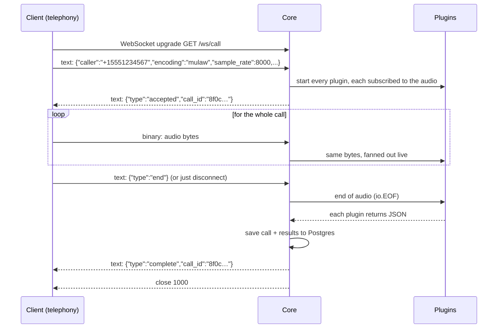

# WebSocket call API

This is the interface a telephony system uses to send a phone call to the core for analysis. It covers the wire protocol, the first message and its identifiers, the audio format (codec, sample rate, channels, message and call length), how to send both sides of a call, how to finish a call, error handling, and worked client examples.

- **Endpoint:** `GET /ws/call` on the core (port 8080 by default), upgraded to a WebSocket.
- **Implementation:** [`internal/server/ws.go`](../internal/server/ws.go)
- **Reference client:** [`cmd/streamcall`](../cmd/streamcall/main.go)

Contents:

1. [Overview](#1-overview)
2. [Connecting](#2-connecting)
3. [The first message: call variables](#3-the-first-message-call-variables)
4. [Audio format](#4-audio-format): codec, sample format, sample rate, channels, message length, call length
5. [Both sides of the call](#5-both-sides-of-the-call): send and receive legs
6. [Sending audio](#6-sending-audio)
7. [Ending a call](#7-ending-a-call)
8. [Server messages](#8-server-messages)
9. [Close codes and errors](#9-close-codes-and-errors)
10. [Limits and timeouts](#10-limits-and-timeouts)
11. [Getting the results](#11-getting-the-results)
12. [Client examples](#12-client-examples)
13. [Bridging from telephony platforms](#13-bridging-from-telephony-platforms)
14. [Integration checklist](#14-integration-checklist)

---

## 1. Overview

One WebSocket connection carries one phone call.



| Step | Direction | Frame type | Content |
|---|---|---|---|
| 1 | client → core | text | A JSON **object** of call variables. It must be the first message. |
| 2 | core → client | text | `{"type":"accepted","call_id":"<uuid>"}` |
| 3 | client → core | binary | Raw audio bytes, any number of messages |
| 4 | client → core | text | `{"type":"end"}`, **or** close or drop the connection |
| 5 | core → client | text | `{"type":"complete","call_id":"<uuid>"}` once the results are saved (only if the client is still connected) |
| 6 | core → client | close | Status 1000 (normal) |

The core does not acknowledge individual audio messages, and sends nothing between `accepted` and `complete`. Analysis results are not streamed back on this socket. Read them afterwards (see [§11](#11-getting-the-results)).

## 2. Connecting

```
ws://<core-host>:8080/ws/call
```

- **No subprotocol, query parameters or headers are required.**
- **No authentication yet.** Anyone who can reach the port can open a call. Until authentication is built (see [architecture.md §11](architecture.md#11-security)), keep the port on a private network or behind a reverse proxy that authenticates clients.
- **TLS.** The core speaks plain HTTP. For `wss://`, put a TLS-terminating proxy (nginx, Caddy, Envoy, a cloud load balancer) in front. Make sure the proxy allows the WebSocket upgrade and doesn't time out idle connections shorter than your longest silence.
- **Browser clients.** The WebSocket library rejects browser connections whose `Origin` header doesn't match the host they connect to. Server-side clients don't send `Origin` and are not affected. Calls are meant to come from telephony servers, not browsers.

## 3. The first message: call variables

The first message must be a **text** frame containing a **JSON object**. Each key/value pair becomes a call **variable**:

- The variables are stored with the call (`variables` in the API).
- Every plugin receives them (`plugin.Input.Variables`).
- They are searchable in the admin UI.

```json
{
  "caller": "+15551234567",
  "callee": "+15557654321",
  "direction": "inbound",
  "pbx_call_id": "a1b2c3d4@pbx01",
  "tenant": "acme",
  "agent_id": "agent-417",
  "queue": "billing",

  "encoding": "mulaw",
  "sample_rate": 8000,
  "channels": 2,
  "channel_labels": ["caller", "agent"]
}
```

### 3.1 Rules

- **It must be an object.** An array, string, number, `null`, invalid JSON, or a binary first frame closes the connection with code **1008**. Nothing is stored.
- **Values can be any JSON:** strings, numbers, booleans, `null`, nested objects and arrays. Plugins receive them as Go values decoded from JSON. Numbers become `float64`, objects `map[string]any`, and arrays `[]any`.
- **The core reserves no keys.** It does not interpret any variable itself. Specific *plugins* look for specific keys (below).
- **Size.** The whole message counts against `MAX_FRAME_BYTES` (1 MiB by default).
- **Timing.** It must arrive within `FIRST_MESSAGE_TIMEOUT` (10 s by default) of the upgrade, or the connection is closed with 1008.
- **Use JSON types deliberately.** Send `"sample_rate": 8000`, not `"sample_rate": "8000"`. The plugins read numbers as JSON numbers, and a quoted number is treated as missing.

### 3.2 Identifiers

The core generates its own **call ID**, a random UUID, and returns it in `accepted`. It is the primary key everywhere: the database row, the audio file name (`<call_id>.raw`), `GET /calls/{id}`, and the admin UI URL.

Send your own identifiers as variables so you can join results back to your systems. The core stores them untouched, and the admin UI search matches any text inside the variables. Useful ones:

| Variable (suggested name) | Why |
|---|---|
| `pbx_call_id`, `sip_call_id`, `call_sid` | Join back to your PBX, CDRs or CPaaS logs |
| `caller`, `callee` | Shown in the admin UI. The UI uses the first of `caller`, `from`, `ani`, `caller_id`, `phone`, `number`, `customer`, `name` as the call's display name. |
| `direction` | `inbound` or `outbound` |
| `tenant`, `account_id` | Multi-tenant deployments |
| `agent_id`, `queue`, `campaign` | Contact-center context for plugins and reviewers |

Store the core's `call_id` against your own record when you receive `accepted`. It is the only way to fetch the results later through `GET /calls/{id}`. The search in `/api/calls?q=` is a fallback.

Variables are stored as given and shown to anyone with admin access. Don't put secrets (tokens, passwords, card numbers) in them.

### 3.3 Audio-format variables

These four variables describe the audio. They are covered in full in [§4 Audio format](#4-audio-format).

| Variable | Type | Required | Example |
|---|---|---|---|
| `encoding` | string | yes | `"mulaw"` |
| `sample_rate` | integer | yes | `8000` |
| `channels` | integer | no (default `1`) | `2` |
| `channel_labels` | array of strings | no | `["caller", "agent"]` |

## 4. Audio format

The core stores and forwards audio as opaque bytes. It never decodes them, so **the client must say exactly what the bytes are**, using the variables in the first message. If the variables are wrong, analysis gets garbage and playback sounds like noise or plays at the wrong speed, and nothing warns you. Check a test call in the admin UI (§14).

### 4.1 Recommended format

If you control the format, send this:

| | |
|---|---|
| **Codec** | G.711 μ-law (`"encoding": "mulaw"`). In Europe and other A-law regions, use `"alaw"`. |
| **Sample rate** | 8000 Hz (`"sample_rate": 8000`) |
| **Channels** | 2, interleaved: channel 0 is the remote party, channel 1 is the local party (`"channels": 2`, `"channel_labels": ["caller", "agent"]`). See [§5](#5-both-sides-of-the-call). |
| **Message length** | 20 ms per binary message = **320 bytes** (160 samples × 1 byte × 2 channels) |
| **Container** | None. Raw samples only. |

```json
{"pbx_call_id": "…", "caller": "+15551234567",
 "encoding": "mulaw", "sample_rate": 8000, "channels": 2, "channel_labels": ["caller", "agent"]}
```

G.711 is what almost every phone network already carries, so in most cases it needs no transcoding: you forward the RTP payload bytes as they are.

**Wideband audio.** If the call is wideband (HD voice: G.722, Opus or AMR-WB), decode it and send `pcm16` at 16000 Hz instead. Don't downsample it to 8 kHz μ-law. The detectors analyze at 16 kHz, and the extra bandwidth carries evidence that narrowband phone audio loses.

### 4.2 Supported codecs

The core accepts **uncompressed PCM and G.711 only**. Compressed codecs must be decoded to PCM before sending.

| `encoding` (canonical) | Codec | Sample format | Bytes per sample | Silence value | Aliases accepted |
|---|---|---|---|---|---|
| `mulaw` | G.711 μ-law (PCMU, RTP payload type 0) | 8-bit companded | 1 | `0xFF` | `ulaw`, `pcmu`, `g711u` |
| `alaw` | G.711 A-law (PCMA, RTP payload type 8) | 8-bit companded | 1 | `0xD5` | `pcma`, `g711a` |
| `pcm16` | Linear PCM | 16-bit signed integer, **little-endian** | 2 | `0x00 0x00` | `linear16`, `s16le`, `l16` |
| `f32le` | Linear PCM | 32-bit IEEE float, little-endian, range −1.0…1.0 | 4 | `0x00000000` | `float32` |
| `u8` | Linear PCM | 8-bit unsigned (128 = zero) | 1 | `0x80` | `pcm8` |

- **Use the canonical lowercase names.** Every component accepts them. The aliases are accepted by the detector service and the admin player, but the `audiostats` plugin matches names exactly and knows only `mulaw`, `ulaw`, `alaw`, `pcm16`, `linear16`, `s16le`, `f32le` and `pcm8`.
- **`pcm16` is little-endian.** RTP L16 (RFC 3551) is big-endian (network byte order), so byte-swap each sample before sending. Big-endian sent as `pcm16` plays as loud noise.

Codecs that are **not** supported and must be decoded first:

| Codec | Decode to |
|---|---|
| G.722 | `pcm16`, **16000 Hz**. G.722's RTP clock rate is advertised as 8000 in SDP for historical reasons, but the audio is 16 kHz. |
| Opus (WebRTC) | `pcm16` at 16000 Hz, or 48000 Hz if that is what your decoder produces |
| AMR-WB (G.722.2) | `pcm16`, 16000 Hz |
| G.729, AMR-NB, iLBC, GSM | `pcm16`, 8000 Hz |
| MP3, AAC, Ogg, FLAC, WAV files (recordings) | Raw `pcm16` at the file's rate. For WAV, just strip the header. |

When you decode a lossy codec, send `pcm16`. Don't re-encode to μ-law: that adds a second round of loss for no gain.

### 4.3 Sample rate

- `sample_rate` is in **samples per second per channel**. 2-channel audio at 8 kHz is `"sample_rate": 8000`, not 16000.
- It must be an integer JSON number, between 4000 and 96000.
- Typical values: 8000 (narrowband telephony), 16000 (wideband), 48000 (WebRTC).
- Send the **native** rate of your audio. Don't resample it yourself: the detector service resamples internally to 16 kHz, and the admin player plays the original rate.

### 4.4 Channels and byte layout

Multi-channel audio is **sample-interleaved**: one sample of channel 0, then one sample of channel 1, and so on, then the next sample of channel 0. A *frame* is one sample of every channel, so a frame is `bytes per sample × channels` bytes long.

```
mono μ-law (channels 1)      : s0 s1 s2 s3 …                        1 byte per frame
stereo μ-law (channels 2)    : A0 B0 A1 B1 A2 B2 …                  2 bytes per frame
mono pcm16 (channels 1)      : s0lo s0hi s1lo s1hi …                2 bytes per frame
stereo pcm16 (channels 2)    : A0lo A0hi B0lo B0hi A1lo A1hi B1lo B1hi …   4 bytes per frame

A = channel 0 (channel_labels[0]),  B = channel 1 (channel_labels[1])
```

- `channels` can be 1–8. Each channel is analyzed separately and gets its own verdict in the report.
- Every channel must have the same encoding and sample rate.
- **Planar layout is not supported**, for example all of channel 0 followed by all of channel 1, or separate messages per channel. Interleave before sending.

### 4.5 Message length

Each binary WebSocket message carries a slice of the stream. Messages have no header, and the core simply joins them end to end.

**Bytes per message** = `sample_rate × bytes_per_sample × channels × milliseconds ÷ 1000`

| Format | 10 ms | **20 ms (recommended)** | 100 ms | 1 s |
|---|---|---|---|---|
| μ-law/A-law, 8 kHz, mono | 80 | **160** | 800 | 8,000 |
| μ-law/A-law, 8 kHz, stereo | 160 | **320** | 1,600 | 16,000 |
| pcm16, 8 kHz, mono | 160 | **320** | 1,600 | 16,000 |
| pcm16, 8 kHz, stereo | 320 | **640** | 3,200 | 32,000 |
| pcm16, 16 kHz, mono | 320 | **640** | 3,200 | 32,000 |
| pcm16, 16 kHz, stereo | 640 | **1,280** | 6,400 | 64,000 |
| pcm16, 48 kHz, stereo | 1,920 | **3,840** | 19,200 | 192,000 |

The rules:

- **Minimum: 1 byte. Maximum: `MAX_FRAME_BYTES`** (1,048,576 bytes by default). A larger message closes the connection with 1009.
- **Recommended: 20 ms**, the usual RTP packet time, so you can forward each packet as it arrives. Anything from 10 ms to 1 s works. Shorter messages mean lower latency, and longer ones mean less per-message overhead.
- **Send whole frames.** The core and the detector service cope with a message that ends partway through a sample or frame (they carry the leftover bytes into the next message), but whole frames are easier to debug and work for any plugin.
- Messages don't have to be the same size.

### 4.6 Call length

| | |
|---|---|
| **Maximum** | `MAX_CALL_DURATION`, 4 hours by default, measured from connection. At the limit the call is ended and saved as if the client hung up. |
| **Minimum** | None for the core: a call with no audio is stored. For an AI-voice verdict, a channel needs at least **2 seconds of speech**. Shorter calls get the verdict `insufficient_audio`. |
| **How the duration is computed** | From the byte count, not the clock: `seconds = audio_bytes ÷ (sample_rate × bytes_per_sample × channels)`. Every timestamp in the results (segments, timeline) is an offset into the audio computed the same way. |
| **Analysis granularity** | The detector service analyzes each channel in 4-second windows (`WINDOW_SECONDS`). A final partial window is analyzed if it is at least 1 second long. Windows that are silent are skipped. |

Because times come from the byte offset, **gaps must be filled**. If your source stops sending during silence (VAD, DTX or comfort noise) or loses packets, send silence samples (the silence values are in §4.2) for the missing time. Otherwise everything after the gap is shifted earlier in the results, and the two channels of a stereo call drift out of step.

## 5. Both sides of the call

A phone call has two directions:

- **receive**: audio from the far end, that is the caller on an inbound call;
- **send**: audio from your side, such as the agent, an IVR or a bot.

At the PBX or SBC these usually arrive as two separate RTP streams. Analyze both: a cloned voice can be on either side, for example a deepfake caller impersonating a customer, or a synthetic voice on a compromised or spoofed outbound leg.

### 5.1 Recommended: one connection, two channels

Send **both directions on one WebSocket as a 2-channel interleaved stream**:

```json
{"pbx_call_id": "a1b2c3d4@pbx01", "caller": "+15551234567", "direction": "inbound",
 "encoding": "mulaw", "sample_rate": 8000,
 "channels": 2, "channel_labels": ["caller", "agent"]}
```

Then send binary messages of 320 bytes each: 160 frames of `[receive sample, send sample]`.

This is fully supported today, and it gives the best result:

- **Attribution.** The AI-voice report has one entry per channel, with its own verdict, risk score and segments. The admin UI says *which* side sounded synthetic ("AudioSeal watermark found on Caller"), draws one timeline lane per channel, and plays the call in stereo.
- **One record.** One call ID, one stored file and one combined verdict (the most serious verdict of the two channels).
- **Aligned timelines.** Both channels share one clock, so a segment at 1:32 on the caller channel and one at 1:32 on the agent channel happened at the same moment.

**Channel order convention.** Channel 0 is the remote party (receive) and channel 1 is the local party (send). Label channels by **role** (`caller`, `agent`, `customer`, `bot`), not by direction. "Send" and "receive" flip depending on whether you look from the PBX or from the phone, while a role label is unambiguous to a reviewer.

### 5.2 Building the stereo stream from two legs

If your platform already produces stereo (many media-fork and recording features have a "stereo" or "separate channels" mode), use it, and check which side is on which channel. Otherwise, interleave the two legs yourself in the bridge:

1. Keep one small queue per leg.
2. Every 20 ms, take 20 ms of audio from each leg. If a leg has nothing (silence suppression, packet loss or a jitter-buffer underrun), use 20 ms of silence for that leg instead.
3. Interleave the two chunks frame by frame and send them as one message.

Driving the output from a fixed 20 ms clock and filling missing audio with silence keeps both channels aligned with real time, even when one side is silent for a long stretch.

```go
// Interleave merges one chunk from each leg into a 2-channel buffer.
// width is bytes per sample (1 for mulaw/alaw, 2 for pcm16). A short or missing
// chunk is padded with silence (pad: 0xFF for mulaw, 0xD5 for alaw, 0x00 for pcm16).
func Interleave(rx, tx []byte, samples, width int, pad byte) []byte {
	out := make([]byte, 0, samples*width*2)
	for i := 0; i < samples; i++ {
		for _, leg := range [2][]byte{rx, tx} { // channel 0 = receive, channel 1 = send
			if off := i * width; off+width <= len(leg) {
				out = append(out, leg[off:off+width]...)
			} else {
				for range width {
					out = append(out, pad)
				}
			}
		}
	}
	return out
}

// Every 20 ms (160 samples at 8 kHz):
//   msg := Interleave(rxQueue.Take(160), txQueue.Take(160), 160, 1, 0xFF)
//   conn.Write(ctx, websocket.MessageBinary, msg)
```

The same thing in Python with NumPy:

```python
import numpy as np

def interleave(rx: bytes, tx: bytes, samples: int, dtype=np.uint8, pad=0xFF) -> bytes:
    """dtype np.uint8 for mulaw/alaw (pad 0xFF / 0xD5), '<i2' for pcm16 (pad 0)."""
    out = np.full((samples, 2), pad, dtype=dtype)
    a = np.frombuffer(rx, dtype=dtype)[:samples]
    b = np.frombuffer(tx, dtype=dtype)[:samples]
    out[: a.size, 0] = a          # channel 0 = receive (remote party)
    out[: b.size, 1] = b          # channel 1 = send (local party)
    return out.tobytes()
```

Things to watch:

- **Use the same clock for both legs.** If you align by RTP timestamps, convert both legs to the same time base before pairing chunks. The two streams have independent random timestamp origins.
- **Both legs must use the same codec and rate.** If one leg is G.711 and the other wideband, decode both to `pcm16` at one rate.
- **Recording files.** A stereo WAV recording is already interleaved, so strip the header and send it as it is with `"channels": 2`.

### 5.3 Alternatives, and why they are worse

| Approach | How | Downsides |
|---|---|---|
| **Two connections, one per direction** | Open two calls. Give both the same correlation variable, and a `leg` variable for each: `{"conversation_id": "a1b2c3d4@pbx01", "leg": "receive", "channel_labels": ["caller"], …}` and `{"conversation_id": "a1b2c3d4@pbx01", "leg": "send", "channel_labels": ["agent"], …}` | The core doesn't link them: you get two call records, two call IDs, two verdicts and two separate pages in the admin UI. Their timelines are aligned only if both connections start at the same moment. There is no combined verdict. Searching the admin UI for the `conversation_id` value shows both. |
| **Mixed to mono** | Sum both directions into one channel (`"channels": 1`, `"channel_labels": ["mixed"]`) | The report can't say who sounded synthetic. Each analysis window mixes two voices, which weakens the evidence from both watermark detectors and classifiers. Use this only if mixed audio is all your platform can give you. |
| **One direction only** | Send only the receive leg (`"channels": 1`, `"channel_labels": ["caller"]`) | It is cheaper (half the analysis load), but a synthetic voice on your own side goes unnoticed. This is reasonable if only inbound callers are in your threat model. |

Use two connections only if your platform makes interleaving impractical. If it does, a small core change could let a second connection join an existing call as another channel.

## 6. Sending audio

After `accepted`, send the audio described in §4 as **binary** WebSocket messages.

### 6.1 Payload

- Each binary message carries raw sample bytes in the format from §4, with **no header and no container**.
  - Don't send a WAV header. Strip the RIFF header from WAV files; `streamcall` does this for you.
  - Don't send RTP headers (12 bytes or more, plus any extensions). Send the payload only.
  - Don't base64-encode the audio, and don't send it as text frames.
- The concatenation of every binary message, in order, is the call's audio. The core writes exactly these bytes to `AUDIO_DIR/<call_id>.raw`.

### 6.2 Pacing

- **Live calls:** send audio as you receive it, about one message every 20 ms. Don't buffer the whole call.
- **Recorded files:** you can send faster than real time. Every window is still analyzed: the detector service queues the work, so the call's results simply arrive later.
- The core applies no backpressure of its own, apart from TCP flow control. Every plugin has an unbounded in-memory queue, so a slow plugin never slows the sender.

### 6.3 Other text messages

Text messages other than `{"type":"end"}` during the audio phase are logged and ignored. You can't change variables in the middle of a call, so put everything you know in the first message.

## 7. Ending a call

There are two ways to end a call, and both save it:

| Ending | What happens | When to use it |
|---|---|---|
| **Graceful:** send text `{"type":"end"}`, then wait for `complete` | The core closes the audio stream, waits for the plugins, saves, sends `{"type":"complete","call_id":…}`, and closes with 1000. | Use this when you want confirmation that the results are stored before you move on. |
| **Hangup:** close or drop the socket | The core treats it as the end of the audio. Plugins still run to completion and the call is still saved. The client just doesn't see `complete`. | Use this on abrupt disconnects, or if you don't care about confirmation. |

How long `complete` takes: the core saves the call once every plugin has returned, and `aivoice` returns only when the detector service has analyzed every window of both channels. Its work is queued behind earlier calls and never dropped. With enough detector capacity this takes a few seconds. When the queue is long it can take minutes, up to `PLUGIN_TIMEOUT` (30 s by default, 30 min in Compose). **Either hang up after sending `end`** (the call is saved anyway; fetch the results later), **or set a read timeout that matches your detector capacity.**

Calls also end without a client action:

| Cause | Effect |
|---|---|
| `MAX_CALL_DURATION` reached (4 h by default) | Treated as a hangup: plugins finish, and the call is saved. The connection may drop before `complete` is sent. |
| Core shutting down (SIGTERM) | Same as above. Shutdown waits up to `SHUTDOWN_TIMEOUT` for in-flight calls to save. |

There is no way to discard a call from the client. Every accepted call is saved.

## 8. Server messages

All server messages are JSON text frames with a `type`:

```json
{"type": "accepted", "call_id": "8f0c2b4e-6a3d-4b1e-9c7a-2d5f1e0b3a91"}
```
```json
{"type": "complete", "call_id": "8f0c2b4e-6a3d-4b1e-9c7a-2d5f1e0b3a91"}
```

| `type` | When | Fields |
|---|---|---|
| `accepted` | Right after a valid first message. Plugins are already subscribed, so the first audio byte you send is seen by every plugin. | `call_id` |
| `complete` | After the results are saved, if the client is still connected | `call_id` |

Ignore unknown message types and unknown fields. Future versions may add them, such as mid-call alerts.

## 9. Close codes and errors

The core reports errors by closing the WebSocket. The close reason is a short human-readable string; don't parse it.

| Code | Name | Cause | Call saved? |
|---|---|---|---|
| 1000 | Normal closure | After `complete` | yes |
| 1008 | Policy violation | The first message was not a JSON object text frame, or didn't arrive within `FIRST_MESSAGE_TIMEOUT` | no |
| 1009 | Message too big | A message exceeded `MAX_FRAME_BYTES` | Yes, if it came after `accepted` |
| 1011 | Internal error | `storage unavailable`: the audio file couldn't be created (no call is started). `failed to save results`: the database write failed after the call. | Not saved in either case. In the second case the audio file is left on disk. |
| (none) | Connection dropped | Max duration, shutdown, network loss | yes |

Recommended client behavior:

| Situation | Action |
|---|---|
| Upgrade fails (connection refused, 5xx) | Retry with backoff. Buffer audio meanwhile only if you can afford the memory. Otherwise, let the call go unanalyzed and log it. |
| 1008 | Bug in the client. Fix the first message; don't retry the same payload. |
| 1009 | Bug in the client. Send smaller messages. |
| 1011 before `accepted` | The core can't write audio (disk full, permissions). Alert. |
| 1011 after `end` | The results were lost. Alert. |
| Connection drops mid-call | The core has saved the call up to that point. You can open a **new** call for the rest of the audio, with the same identifying variables plus something like `"continuation_of": "<first call_id>"`, but the core will not join them. |

Never block the actual phone call on the analysis connection. Treat the core as a side channel: if it is down, the call goes ahead unanalyzed.

## 10. Limits and timeouts

All are environment variables on the core (see [operations.md](operations.md#configuration)).

| Setting | Default | Applies to |
|---|---|---|
| `FIRST_MESSAGE_TIMEOUT` | 10s | Upgrade → first message |
| `MAX_FRAME_BYTES` | 1048576 | Every incoming message, including the first |
| `MAX_CALL_DURATION` | 4h | Measured from the upgrade |
| `PLUGIN_TIMEOUT` | 30s (30m in Compose) | Audio end → all plugins finished |
| `SHUTDOWN_TIMEOUT` | 60s | Shutdown waiting for in-flight calls |

There is no idle timeout during the audio phase. A connected client that sends nothing keeps the call open until `MAX_CALL_DURATION`. TCP keepalive and any proxy timeouts apply.

There is no limit on concurrent calls. Every call costs a goroutine per plugin, memory for queued frames, an open file, and a connection to the detector service. Size your deployment for your peak concurrent calls. See [operations.md](operations.md#capacity).

## 11. Getting the results

The results are saved when the call ends. Fetch them with the call ID from `accepted`:

```sh
curl http://core:8080/calls/8f0c2b4e-6a3d-4b1e-9c7a-2d5f1e0b3a91
```

```json
{
  "id": "8f0c2b4e-6a3d-4b1e-9c7a-2d5f1e0b3a91",
  "variables": {"caller": "+15551234567", "encoding": "mulaw", "sample_rate": 8000, "channels": 2,
                "channel_labels": ["caller", "agent"]},
  "results": {
    "audiostats": {"frames": 3000, "bytes": 960000, "largest_frame": 320, "duration_seconds": 60},
    "aivoice": {"verdict": "no_evidence", "risk_score": 0.36, "channels": [ … ], "caveats": [ … ]}
  },
  "audio_bytes": 960000,
  "started_at": "2026-11-18T14:02:11.402Z",
  "ended_at": "2026-11-18T14:03:12.118Z",
  "expires_at": "2026-12-18T14:03:12.118Z"
}
```

- `results` is keyed by plugin name. A plugin that failed has `{"error": "…"}` in place of its output.
- The AI-voice report format is documented in [detectors/README.md](../detectors/README.md#report-resultsaivoice).
- The full read API, including listing and searching calls and downloading audio, is in [http-api.md](http-api.md).
- You can also look at the call in the admin UI: `http://core:8080/admin/#/calls/<call_id>`.

There is no push notification when results are ready. Either wait for `complete` on the socket, or poll `GET /calls/{id}`, which returns 404 until the call is saved.

## 12. Client examples

To keep them short, the examples send 8 kHz **mono** μ-law in 20 ms (160-byte) messages. For the recommended stereo format, set `"channels": 2` and `channel_labels`, build each message with the interleaver from [§5.2](#52-building-the-stereo-stream-from-two-legs), and send 320 bytes every 20 ms. See [§4.5](#45-message-length) for other formats.

### 12.1 Command line: `streamcall`

```sh
# A WAV file (header stripped automatically), paced in real time:
go run ./cmd/streamcall -url ws://localhost:8080/ws/call -file call.wav \
  -vars '{"caller":"+15551234567","pbx_call_id":"abc123","encoding":"pcm16","sample_rate":8000}' \
  -chunk 320 -interval 20ms

# Simulate an abrupt hangup (no end message):
go run ./cmd/streamcall -file call.raw -vars '{"encoding":"mulaw","sample_rate":8000}' -hangup
```

| Flag | Default | |
|---|---|---|
| `-url` | `ws://localhost:8080/ws/call` | Core endpoint |
| `-file` | (none) | Audio file. WAV headers are stripped, and anything else is sent raw. Without it, a call with no audio is sent. |
| `-vars` | `{}` | First message |
| `-chunk` | 320 | Bytes per binary message |
| `-interval` | 0 | Delay between messages (0 = as fast as possible) |
| `-hangup` | false | Disconnect instead of sending `end` |

### 12.2 Go

```go
package callclient

import (
	"context"
	"encoding/json"
	"fmt"
	"io"
	"log"
	"time"

	"github.com/coder/websocket"
)

// streamCall sends one call and returns the core's call ID once results are saved.
func streamCall(ctx context.Context, url string, vars map[string]any, audio io.Reader) (string, error) {
	conn, _, err := websocket.Dial(ctx, url, nil)
	if err != nil {
		return "", err
	}
	defer conn.CloseNow()
	conn.SetReadLimit(1 << 16)

	first, _ := json.Marshal(vars)
	if err := conn.Write(ctx, websocket.MessageText, first); err != nil {
		return "", err
	}
	var acc struct {
		Type   string `json:"type"`
		CallID string `json:"call_id"`
	}
	_, data, err := conn.Read(ctx)
	if err != nil {
		return "", err // a 1008 close means the first message was rejected
	}
	if err := json.Unmarshal(data, &acc); err != nil || acc.Type != "accepted" {
		return "", fmt.Errorf("unexpected reply %q", data)
	}
	log.Printf("call_id %s", acc.CallID) // store this against your own call record

	buf := make([]byte, 160) // 20 ms of 8 kHz mulaw
	for {
		n, err := io.ReadFull(audio, buf)
		if n > 0 {
			if werr := conn.Write(ctx, websocket.MessageBinary, buf[:n]); werr != nil {
				return acc.CallID, werr // the core saves what it received
			}
		}
		if err == io.EOF || err == io.ErrUnexpectedEOF {
			break
		}
		if err != nil {
			return acc.CallID, err
		}
	}

	if err := conn.Write(ctx, websocket.MessageText, []byte(`{"type":"end"}`)); err != nil {
		return acc.CallID, err
	}
	rctx, cancel := context.WithTimeout(ctx, 2*time.Minute) // > PLUGIN_TIMEOUT
	defer cancel()
	if _, _, err := conn.Read(rctx); err != nil { // {"type":"complete",...}
		return acc.CallID, err
	}
	conn.Close(websocket.StatusNormalClosure, "")
	return acc.CallID, nil
}
```

### 12.3 Python (`websockets`)

```python
import asyncio, json
import websockets  # pip install websockets

async def stream_call(url: str, variables: dict, audio_chunks):
    """audio_chunks: an async iterator of bytes (e.g. 160-byte mulaw frames)."""
    async with websockets.connect(url, max_size=2**16) as ws:
        await ws.send(json.dumps(variables))           # str  -> text frame
        accepted = json.loads(await ws.recv())
        assert accepted["type"] == "accepted", accepted
        call_id = accepted["call_id"]

        async for chunk in audio_chunks:
            await ws.send(chunk)                        # bytes -> binary frame

        await ws.send(json.dumps({"type": "end"}))
        complete = json.loads(await asyncio.wait_for(ws.recv(), timeout=120))
        return call_id, complete["type"] == "complete"

async def file_chunks(path, size=160, interval=0.02):
    with open(path, "rb") as f:
        while chunk := f.read(size):
            yield chunk
            await asyncio.sleep(interval)               # real-time pacing

call_id, ok = asyncio.run(stream_call(
    "ws://localhost:8080/ws/call",
    {"caller": "+15551234567", "pbx_call_id": "abc123",
     "encoding": "mulaw", "sample_rate": 8000},
    file_chunks("call.ulaw"),
))
print(call_id, ok)
```

### 12.4 Node.js (`ws`)

```js
import WebSocket from "ws"; // npm install ws
import { createReadStream } from "node:fs";

function streamCall(url, variables, path) {
  return new Promise((resolve, reject) => {
    const ws = new WebSocket(url);
    let callId;
    ws.on("open", () => ws.send(JSON.stringify(variables)));      // string -> text frame
    ws.on("message", async (data, isBinary) => {
      const msg = JSON.parse(data.toString());
      if (msg.type === "accepted") {
        callId = msg.call_id;
        for await (const chunk of createReadStream(path, { highWaterMark: 160 })) {
          ws.send(chunk);                                         // Buffer -> binary frame
          await new Promise((r) => setTimeout(r, 20));
        }
        ws.send(JSON.stringify({ type: "end" }));
      } else if (msg.type === "complete") {
        ws.close(1000);
        resolve(callId);
      }
    });
    ws.on("close", (code, reason) => { if (code !== 1000) reject(new Error(`closed ${code} ${reason}`)); });
    ws.on("error", reject);
  });
}

console.log(await streamCall("ws://localhost:8080/ws/call",
  { caller: "+15551234567", encoding: "mulaw", sample_rate: 8000 }, "call.ulaw"));
```

### 12.5 Testing with raw tools

To check connectivity by hand (no audio):

```sh
# websocat: type the first message, then {"type":"end"}
websocat ws://localhost:8080/ws/call
{"caller":"test"}
{"type":"end"}
```

## 13. Bridging from telephony platforms

Most platforms can fork call media to a WebSocket, but in their own message format. A small bridge translates it to this protocol: the platform's metadata becomes the first message, and its media payloads become binary frames. The patterns below are sketches. Check your platform's current documentation for exact field names.

### 13.1 Twilio Media Streams

Twilio sends JSON text messages: `start` (with `callSid`, `streamSid` and `customParameters`), then `media` messages carrying base64 8 kHz mu-law, then `stop`. A bridge:

```python
import base64, json
import websockets

CORE = "ws://core:8080/ws/call"

async def twilio_handler(twilio_ws):
    core = None
    async for raw in twilio_ws:
        msg = json.loads(raw)
        ev = msg.get("event")
        if ev == "start":
            s = msg["start"]
            core = await websockets.connect(CORE)
            await core.send(json.dumps({
                "call_sid": s["callSid"], "stream_sid": s["streamSid"],
                **s.get("customParameters", {}),          # e.g. caller, tenant from <Parameter>
                "encoding": "mulaw", "sample_rate": 8000, "channels": 1,
            }))
            await core.recv()                             # accepted
        elif ev == "media" and core:
            await core.send(base64.b64decode(msg["media"]["payload"]))
        elif ev == "stop" and core:
            await core.send(json.dumps({"type": "end"}))
            await core.close()                            # or await complete
            core = None
    if core:                                              # Twilio hung up without stop
        await core.close()

# serve with: websockets.serve(twilio_handler, "0.0.0.0", 8765)
```

This bridge sends the caller only. To analyze both sides, start the stream with `track="both_tracks"`. Twilio then sends `inbound` (caller) and `outbound` (your side) media messages separately, each with its own 20 ms payload. Queue each track's payloads, and every 20 ms send `interleave(inbound, outbound, 160)` from [§5.2](#52-building-the-stereo-stream-from-two-legs), with `"channels": 2, "channel_labels": ["caller", "agent"]` in the first message.

### 13.2 SIP/RTP media forks (FreeSWITCH, Asterisk, SBCs)

- **FreeSWITCH** (`mod_audio_fork` and similar) and **Asterisk** (`externalMedia`, AudioSocket) can stream raw call audio to a WebSocket or TCP endpoint. Send the channel variables you care about (UUID, ANI, DNIS, account) as the first message, and the raw L16 or G.711 payload as binary frames. Check the byte order: Asterisk `slin` is little-endian host order, while RTP L16 is big-endian.
- Many media forks have a stereo mode that puts each direction on its own channel; FreeSWITCH `mod_audio_fork`, for example, has a `stereo` mix type. Use it rather than a mixed (mono) mode, and check which party lands on which channel. See [§5](#5-both-sides-of-the-call).
- **SIPREC** (RFC 7866) recording sessions from an SBC carry two RTP streams, one per party. A SIPREC server can interleave them into a 2-channel stream ([§5.2](#52-building-the-stereo-stream-from-two-legs)), with `channel_labels` taken from the recording metadata.

### 13.3 Recorded calls (batch)

For call recordings, stream each file as fast as you like: the analysis is queued and every window is analyzed. Put the recording's metadata in the first message, including the original call start time, because the core's `started_at` is when the upload began.

## 14. Integration checklist

- [ ] The first message is a JSON object sent as a **text** frame, within 10 s of connecting.
- [ ] `encoding` uses a canonical name (`mulaw`, `alaw`, `pcm16`, `f32le`, `u8`) and matches the actual bytes. Compressed codecs (G.722, G.729, Opus, AMR) are decoded to `pcm16` first.
- [ ] `sample_rate` is the native per-channel rate, as a JSON number (`8000`, not `"8000"`). G.722 is 16000.
- [ ] Both sides of the call are sent as `"channels": 2`, interleaved frame by frame, with channel 0 = remote party and channel 1 = local party, and `channel_labels` naming their roles.
- [ ] Your own call identifier is included as a variable, and the returned `call_id` is stored on your side.
- [ ] Audio is sent as **binary** frames of raw samples: no WAV or RTP headers, no base64, and `pcm16` little-endian.
- [ ] Messages are whole frames, about 20 ms each (320 bytes for stereo 8 kHz μ-law), and always under `MAX_FRAME_BYTES`.
- [ ] Silence and lost packets are filled with silence samples, so the audio length matches real time and both channels stay aligned.
- [ ] The call ends with `{"type":"end"}`. Then either hang up and fetch the results later, or wait for `complete` with a timeout that allows for the detector queue.
- [ ] Connection failures never affect the real phone call.
- [ ] The connection runs over a private network or an authenticating TLS proxy.
- [ ] One test call has been checked in the admin UI: the audio plays at the right speed and pitch, each side is on the correctly labeled channel, and the call length matches the real call.
